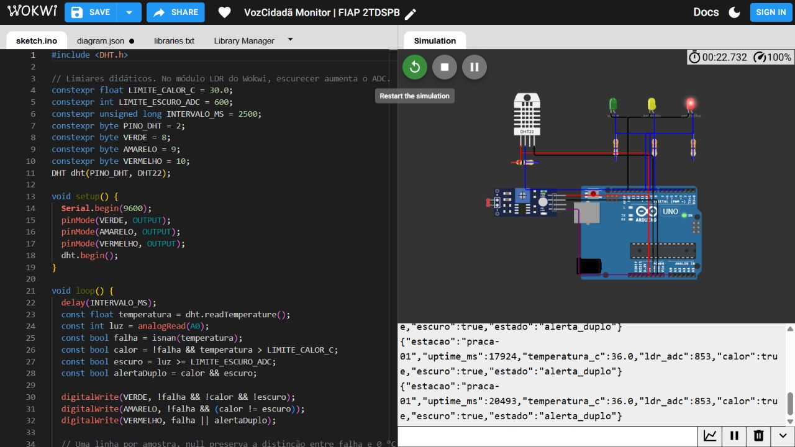
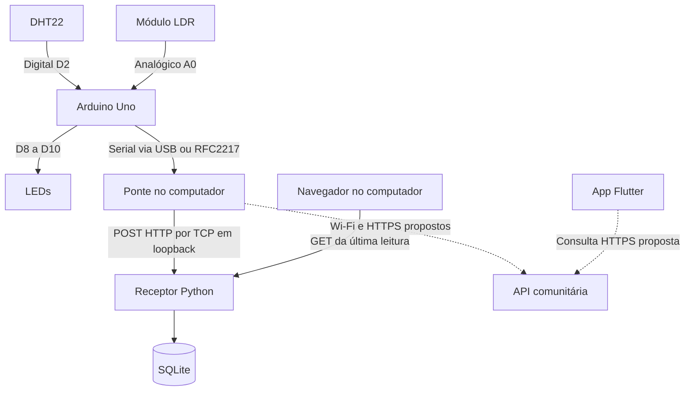

# VozCidadã Monitor

Estação ambiental de demonstração para a Global Solution FIAP 2026/2, turma **2TDSPB**. Um morador relata falta de iluminação em uma praça. A equipe que acompanha as propostas do bairro pode comparar o relato com a luminosidade registrada naquele ponto e solicitar uma vistoria. A temperatura oferece uma segunda informação sobre as condições de uso do espaço. O projeto se relaciona aos ODS 11 (espaços públicos) e 16 (participação cidadã).

**[Executar o projeto no Wokwi](https://wokwi.com/projects/481002576769421313)** · [Testes e capturas reais](TESTES.md) · [Aplicativo Flutter VozCidadã](https://github.com/gcorrea4/vozcidadao-flutter)

| Integrante | RM |
| --- | --- |
| Kayque Duarte | 567980 |
| Eric Maciel | 567398 |
| Gabriel Correa | 567903 |

## Demonstração no navegador

Abra o Wokwi pelo link acima e pressione ▶. Com 24 °C e 400 lux, o LED verde acende e o monitor serial exibe a primeira leitura em cerca de três segundos. Clique no DHT22 e ajuste a temperatura para 36 °C. Depois clique no módulo LDR e reduza a iluminação para 10 lux. O LED passa por amarelo e vermelho. Volte a 24 °C mantendo 10 lux para revelar o alerta isolado de baixa luz. Aguarde uma nova linha serial após cada ajuste.



## Circuito

| Componente | Conexão com Arduino Uno R3 | Justificativa |
| --- | --- | --- |
| DHT22 | VCC a 5 V, GND comum, dados em D2, pull-up de 10 kΩ entre dados e 5 V. NC livre. | A leitura digital entrega temperatura em °C e permite detectar falha de comunicação. O pino SDA do modelo usa o protocolo próprio do DHT. |
| Módulo LDR | VCC a 5 V, GND comum e AO em A0. DO livre. | O divisor resistivo integrado fornece uma tensão contínua. O ADC de 10 bits do Uno permite ajustar o disparo em software. Neste circuito, escurecer aumenta a leitura. |
| LEDs verde, amarelo e vermelho | D8, D9 e D10 respectivamente. Cada saída passa por um resistor de 330 Ω até o ânodo. Cátodos ao GND. | Um único LED indica o estado a cada leitura. O texto serial permite distinguir o motivo do alerta. |
| Computador | Cabo USB no Uno físico ou serial virtual na simulação | A ponte usa a interface de rede do computador para transmitir os dados. |

A montagem reproduzível está em [diagram.json](diagram.json), com ligações diretas. Em protoboard, use trilhas comuns de alimentação e preserve as mesmas conexões.

## Processamento e alertas

O [firmware](firmware/monitor/monitor.ino) espera 2,5 s por ciclo, lê os dois sensores, classifica a amostra, aciona os LEDs e envia um objeto JSON por linha. Os limiares configuráveis `LIMITE_CALOR_C` e `LIMITE_ESCURO_ADC` ficam no início do sketch. São valores didáticos. Os lux exibidos no controle do Wokwi servem de entrada para o modelo. A unidade transmitida pelo Uno é a contagem do ADC.

| Condição | Estado | LED |
| --- | --- | --- |
| Até 30 °C e ADC abaixo de 600 | `normal` | Verde |
| Acima de 30 °C e ADC abaixo de 600 | `calor` | Amarelo |
| Até 30 °C e ADC a partir de 600 | `baixa_luz` | Amarelo |
| Acima de 30 °C e ADC a partir de 600 | `alerta_duplo` | Vermelho |
| Temperatura inválida | `falha_dht` | Vermelho. A temperatura e a flag de calor são nulas. |

## Arquitetura de comunicação



**Bancada.** O Uno emite NDJSON na UART, a 9600 bit/s, 8N1. O computador recebe as linhas pela porta USB serial, pela serial virtual do Wokwi para VS Code ou pela reprodução de uma captura do editor web. Cada objeto segue por TCP/IP para `POST /api/v1/leituras` em `127.0.0.1:8765`. O receptor valida, grava no SQLite e responde com HTTP 201. A consulta `GET /api/v1/leituras/ultima` devolve a amostra mais recente. O Uno usa pinos e porta serial; o endereço IP pertence ao computador.

Amostra real do monitor serial:

```json
{"estacao":"praca-01","uptime_ms":20493,"temperatura_c":36.0,"ldr_adc":853,"calor":true,"escuro":true,"estado":"alerta_duplo"}
```

A ponte acrescenta `origem` com valor `serial` ou `replay`. O receptor acrescenta `recebido_em` em UTC. O campo `uptime_ms` conta o tempo desde o boot e volta a zero ao reiniciar. Um replay preserva o uptime de origem e recebe um novo horário de recepção.

**Uso comunitário proposto.** O computador da estação obteria IP, gateway e DNS por DHCP. Pelo Wi-Fi, os dados passariam do ponto de acesso ao roteador e ao serviço identificado por nome DNS. A ponte enviaria HTTPS na porta 443 com validação do certificado e credencial específica de escrita por estação. O Flutter consultaria a API por HTTPS para exibir nome da praça, valores, validade e horário da última recepção. Essa integração requer uma API publicada. O serviço de demonstração escuta somente no loopback. A aplicação transmite medidas ambientais e um identificador demonstrativo de praça.

## Reproduzir a comunicação

Na raiz do projeto, com Python 3.10 ou posterior:

1. Execute `python rede/receptor.py` em um terminal.
2. Em outro terminal, execute `python rede/ponte.py --arquivo evidencias/serial-wokwi.ndjson`. A ponte envia as seis amostras reais capturadas no simulador e informa cada confirmação 201.
3. Abra [a consulta da última leitura no computador](http://127.0.0.1:8765/api/v1/leituras/ultima). Confira `alerta_duplo`, 36 °C, ADC 853 e `origem: replay`. O histórico fica em `leituras.sqlite3`.

Para usar a porta física ou o Wokwi para VS Code, instale `python -m pip install -r rede/requirements.txt`. Com o receptor em execução, use **uma** das fontes:

```shell
python rede/ponte.py --serial COM3
python rede/ponte.py --serial rfc2217://127.0.0.1:4000
```

Substitua COM3 pela porta real do Uno. Feche outros leitores dessa porta. A porta TCP 4000 transporta a serial virtual do simulador local. O navegador Wokwi permite copiar a saída serial para um arquivo NDJSON e usar o primeiro modo.

## Compilar e executar o firmware

No Arduino IDE, abra `firmware/monitor/monitor.ino`, selecione **Arduino Uno** e instale as bibliotecas listadas em `libraries.txt`. Para compilar com Arduino CLI na raiz:

```shell
arduino-cli core update-index
arduino-cli core install arduino:avr@1.8.8
arduino-cli lib install "Adafruit Unified Sensor@1.1.15" "DHT sensor library@1.4.6"
arduino-cli compile --fqbn arduino:avr:uno --output-dir build firmware/monitor
```

No VS Code com a extensão Wokwi configurada, abra a raiz e use **Wokwi: Start Simulator**. O arquivo `wokwi.toml` aponta para `build/monitor.ino.hex`. Para remontar no editor web, crie um projeto Uno, cole o sketch em `sketch.ino`, importe a montagem de `diagram.json` e instale as dependências indicadas.

## Testes e automação

O [workflow do GitHub Actions](.github/workflows/verificar.yml) compila o sketch para ATmega328P, verifica a classificação e as saídas digitais em nove casos e executa o ensaio da ponte HTTP com SQLite. Uma execução aprovada disponibiliza o artifact `vozcidadao-uno` com o arquivo HEX. Ao extrair o artifact para uso com a extensão Wokwi, coloque `monitor.ino.hex` na pasta `build/`. O [relatório de testes](TESTES.md) registra os resultados observados nesta implementação.

## Alcance e limitações

Cada estação representa as condições em um ponto. Sombra sobre o LDR e horário alteram a medida e exigem contexto e calibração para uso em campo. Uma entrada analógica flutuante pode parecer válida se o LDR for desconectado. Se a rede cair, o alerta local continua e a ponte informa a falha de envio. Uma instalação permanente precisaria de fila persistente e reenvio com identificadores únicos para evitar duplicatas. Os ensaios abrangeram simulação e rede local. A validação em praça e a integração com o aplicativo Flutter são etapas de implantação.


[Documentação do Uno](https://docs.wokwi.com/parts/wokwi-arduino-uno) · [DHT22](https://docs.wokwi.com/parts/wokwi-dht22) · [Modelo de luminosidade](https://docs.wokwi.com/parts/wokwi-photoresistor-sensor) · [Configuração da serial virtual](https://docs.wokwi.com/vscode/project-config)
